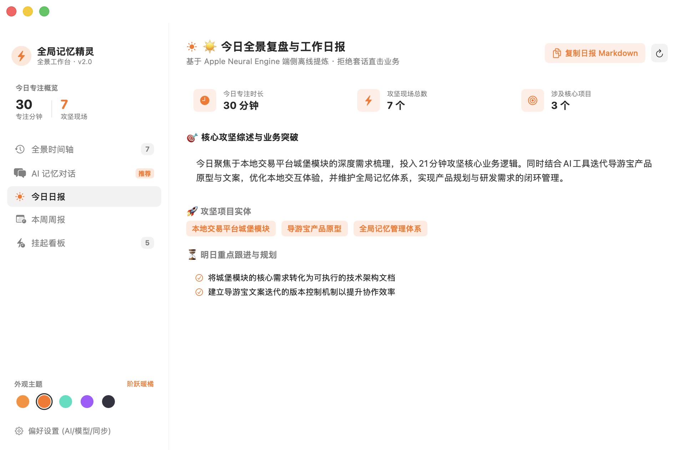
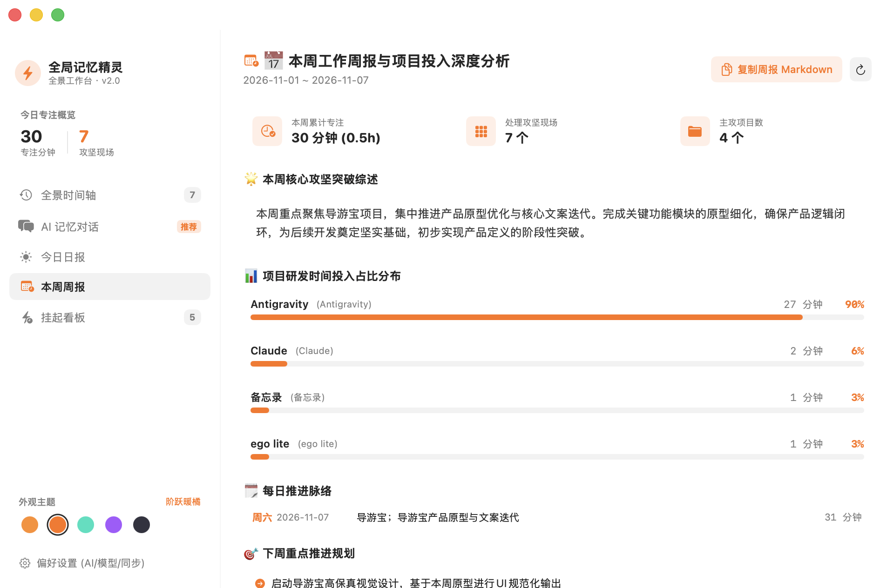
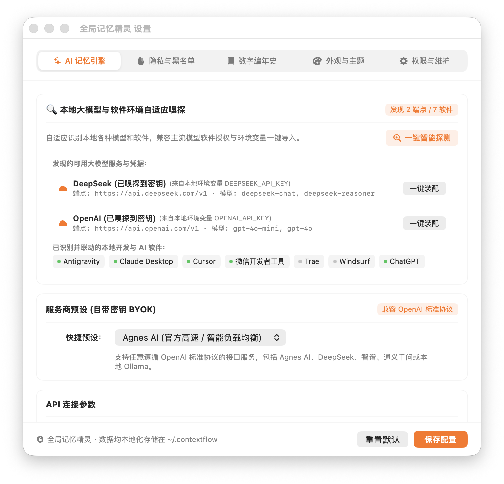
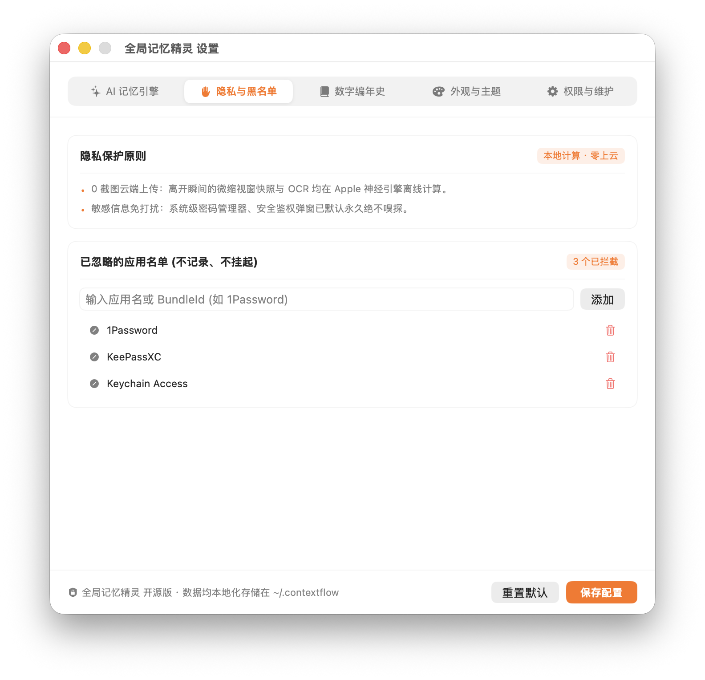
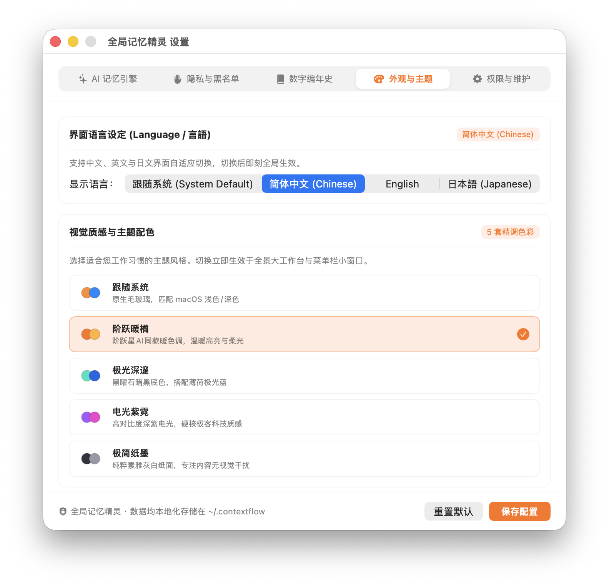
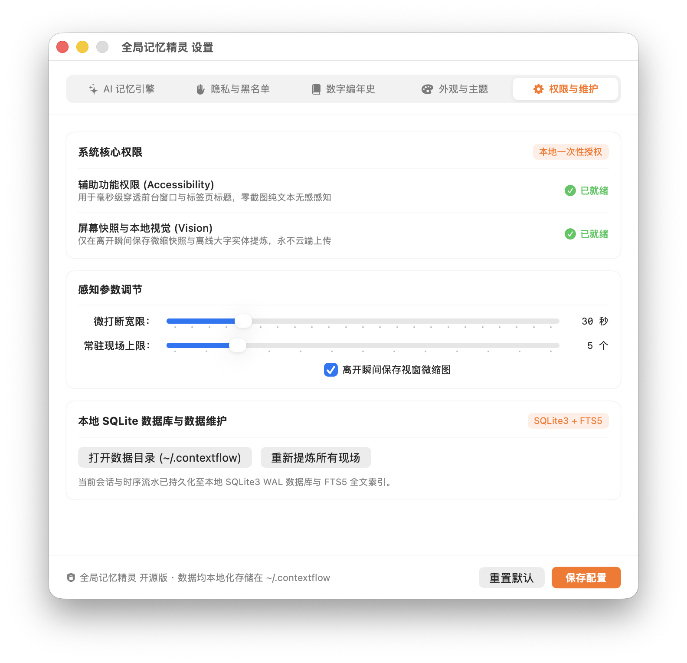

# 全局记忆精灵 ⚡️ (ContextFlow)

<p align="center">
  <a href="README.md"><strong>🇨🇳 简体中文</strong></a> |
  <a href="README_EN.md">🇺🇸 English</a> |
  <a href="README_JA.md">🇯🇵 日本語</a>
</p>

<p align="center">
  
  
  
  
  
  
</p>

<p align="center">
  <strong>专为 macOS 打造的高性能工业级全局数字记忆、视窗现场守护与 AI 智能工作复盘助手。</strong><br>
  参考阶跃星辰（跃问 StepFun）现代桌面端设计语言，内置工业级 SQLite3 + FTS5 全文检索引擎，自带模型密钥（BYOK）与高可用多 Key 容灾轮换池，0 截图云端上传，完全离线可用与开源保护。
</p>

---

## 📸 界面全景一览 (Interface Gallery)

### 🖥️ 1. 全景时间轴主工作台 (Full Timeline Dashboard)
> 阶跃星辰质感宽屏布局，集成多维分类 Chips（全部、💻开发、🌐浏览器、💬沟通、📝文档），顶部支持全局搜索与回车即时问答，右侧支持全景视窗详情审查与【恢复当时视窗现场】一键直达。

<p align="center">
  
</p>

---

### 💬 2. AI 全局记忆对话搜索 (Ask Memory Chat)
> 对标商业级 AI 核心能力，直接针对全景记忆进行自然语言提问（如“我在反重力里开发了什么项目 进度如何”），系统结合本地真实 SQLite 数据库足迹与防幻觉屏障，秒级输出高清晰度客观业务答复并提供关联现场证据。

<p align="center">
  
</p>

---

### 📅 3. 日报与周报全景复盘大屏 (Daily & Weekly Wrap-up)

<table align="center">
  <tr>
    <td align="center" width="50%">
      <strong>☀️ 今日全景复盘日报 (Daily Hub)</strong><br><br>
      
      <br>
      <em>大屏指标看板 · 核心攻坚综述 · 明日规划 · Markdown 一键导出</em>
    </td>
    <td align="center" width="50%">
      <strong>📅 本周工作周报与投入分析 (Weekly Hub)</strong><br><br>
      
      <br>
      <em>项目研发投入占比可视化进度条 · 每日脉络追踪 · 下周重点推进规划</em>
    </td>
  </tr>
</table>

---

### ⚙️ 4. 现代化偏好设置与本地模型自适应识别 (Native Preferences & Model Auto-Discovery)
> 彻底重构为原生分段导航栏，杜绝折叠溢出与浮动黑条，排版严整考究。支持自带密钥 (BYOK)、本地大模型 (Ollama, LM Studio) 与开发环境凭据自适应嗅探 (DeepSeek Harness 机制)、高可用多 Key 智能轮换池、隐私黑名单、数字编年史 GitHub 归档、5 套个性化主题与多语言国际化 (i18n)。

<table align="center">
  <tr>
    <td align="center" width="50%">
      <strong>🔍 本地大模型与软件环境自适应嗅探</strong><br><br>
      
    </td>
    <td align="center" width="50%">
      <strong>📚 数字编年史与 GitHub 私有归档</strong><br><br>
      
    </td>
  </tr>
  <tr>
    <td align="center" width="50%">
      <strong>🛡️ 隐私保护与应用拦截黑名单</strong><br><br>
      
    </td>
    <td align="center" width="50%">
      <strong>🎨 5 套精调阶跃质感配色与多语言设定 (i18n)</strong><br><br>
      
    </td>
  </tr>
</table>

<p align="center">
  <br>
  <em>⚙️ 系统权限即时检测 · 离开瞬间微缩图 · 本地 SQLite3 + FTS5 引擎状态与维护</em>
</p>

---

## 🌟 核心特性与架构亮点 (Key Highlights)

### 1. 🗄️ 工业级 SQLite3 + FTS5 全文检索引擎
* **原生嵌入式架构**：告别脆弱的扁平 JSON 文件，全面迁移至 macOS 原生 SQLite3，启用高并发 WAL 模式与 8MB 内存页缓存；
* **FTS5 倒排索引全文搜索**：基于 `unicode61` 分词器，毫秒级检索数万条窗口标题、正文、代码路径与会话意图；
* **进程安全与持久化**：时序足迹实时落盘于 `~/.contextflow/contextflow.sqlite3`，异常断电或退出零数据丢失。

### 2. ⚡️ 高可用多 API Key 智能轮换池与超时故障转移 (Failover)
* **BYOK 自带密钥自由**：全面兼容 OpenAI 标准协议，预设支持 Agnes AI、DeepSeek、智谱 GLM-4-Flash、OpenAI、SiliconFlow 及本地 Ollama；
* **智能轮换机制**：高频意图提炼时按顺序分配各 Key 负载，有效分散限流风险；
* **秒级故障转移**：遇到 `429 Too Many Requests` 或网络连接超时，自动无感切换至备用通道继续执行，保障体验不中断；
* **开箱即用离线保障**：若未填写 API Key 或处于断网环境，自动启用端侧 Apple Neural Engine 离线实体提取与对话应答，完全可用。

### 3. 🛡️ 深度视窗穿透与防幻觉降噪屏障
* **内核级无感感知**：基于 CoreGraphics 与 Accessibility 穿透 Chromium 内核与 IDE，直接获取真实标签页标题、文档路径与前台正文；
* **开发环境侧边栏降噪**：内置黑名单深度屏蔽 Antigravity、Claude 等工具侧边栏的历史会话列表，杜绝将背景杂乱信息误当成当前任务；
* **事实边界锁定**：在提问与提炼时注入严格反幻觉防线，绝不凭空捏造怪异虚假任务。

### 4. 📊 商业级全景复盘与周报分析大屏
* **今日全景日报**：结构化归纳今日攻坚项目、专注分钟数、核心突破与明日行动清单；
* **本周工作周报**：跨 7 天聚合统计各项目时间投入，精准计算各项目研发**耗时与占比百分比（附可视化进度条）**；
* **一键复制 Markdown**：一键生成排版工整的标准 Markdown，快速粘贴至飞书、语雀、钉钉或向团队汇报。

---

## 🚀 极速上手 (Quick Start)

### 1. 编译与打包
确保运行环境为 macOS 13.0+，并已安装 Xcode 命令行工具 (`xcode-select --install`)。

```bash
# 1. 克隆代码仓库
git clone https://github.com/lianbing22/context-flow.git
cd context-flow

# 2. 一键编译与代码签名
chmod +x build.sh
./build.sh
```

编译完成后，将在项目根目录下生成已完成长效代码签名的 `全局记忆精灵.app`。

### 2. 启动与授权
直接双击打开 `全局记忆精灵.app`，或在终端中运行：
```bash
open 全局记忆精灵.app
```

* **权限指引**：首次启动时，请在【偏好设置 - 权限与维护】中开启 **辅助功能 (Accessibility)** 权限，用于毫秒级穿透前台窗口标题与业务正文。
* **数据目录**：所有会话、时序流水与快照均保存在本地 `~/.contextflow` 目录下，100% 本地掌控。

---

## 📖 核心使用场景指南 (Usage Guide)

### 场景一：随时唤醒全景工作台
* 点击 macOS 菜单栏上的闪电图标，在微型挂起卡片中点击【全景大工作台】展开宽屏界面；
* 支持自由拉伸缩放与全屏排布，任意屏幕尺寸均舒展通透。

### 场景二：与 AI 记忆对话，查找工作足迹
* 在工作台左侧点击【AI 记忆对话】，或在时间轴搜索框输入问题直接按回车；
* 示例提问：
  - *“我在反重力里开发了什么项目 进度如何？”*
  - *“今天在微信开发者工具中推进了什么？”*
  - *“总结今天在各个应用的花费时间”*

### 场景三：下班复盘与周五汇报
* 点击【今日日报】或【本周周报】，点击右上角的【复制日报 Markdown】或【复制周报 Markdown】；
* 直接粘贴到周会报告、团队协作群或个人数字笔记中。

### 场景四：配置高可用 API Key 密钥池
* 打开【偏好设置 - AI 记忆引擎】；
* 在“API 密钥”输入框中粘贴您的 Key（支持多行录入多个 Key）；
* 开启【多 Key 智能轮换与超时自动故障转移】，点击【测试连通性】验证密钥池可用性。

---

## 🛠️ 项目工程结构 (Repository Structure)

```text
context-flow/
├── Sources/
│   ├── main.swift                 # 应用生命周期、外部通知分发与命令行处理
│   ├── ContextEngine.swift        # 状态机核心：工作现场切换、计时与挂起逻辑
│   ├── DatabaseManager.swift      # SQLite3 WAL 核心数据库与 FTS5 全文检索引擎
│   ├── ContextStore.swift         # 统一存储协调器 (SQLite 双向同步)
│   ├── WindowInspector.swift      # 窗口感知探查器：CoreGraphics 与 Accessibility 穿透
│   ├── AISummarizer.swift         # AI 意图提炼、多 Key 容灾轮换池与记忆对话
│   ├── DashboardView.swift        # 阶跃质感全景工作台大界面 (时间轴、对话、日报、周报)
│   ├── SettingsView.swift         # 现代原生偏好设置面板 (原生胶囊导航、BYOK、权限)
│   ├── Views.swift                # 状态栏微型悬浮窗与通用 UI 组件
│   └── LifeLogSyncManager.swift   # GitHub 私有归档自动化同步
├── docs/
│   └── screenshots/               # 全量高清界面截图 (无隐私暴露)
├── build.sh                       # 一键编译与长效代码签名脚本
├── Info.plist                     # macOS 应用清单与权限描述
└── README.md                      # 项目核心说明与使用引导
```

---

## 📄 开源许可证 (License)

本项目采用 [MIT License](LICENSE) 开源许可证。
欢迎提交 Issue 与 Pull Request 共同完善！
