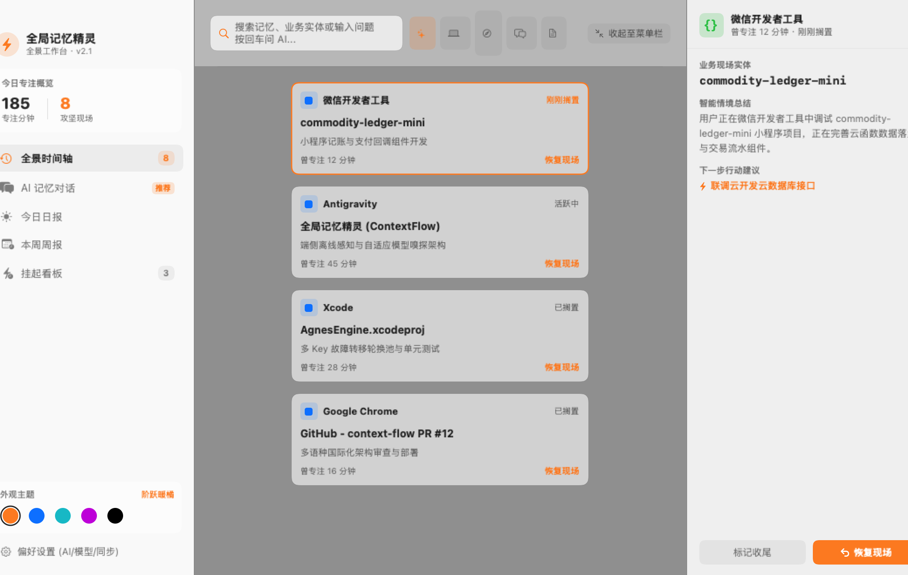
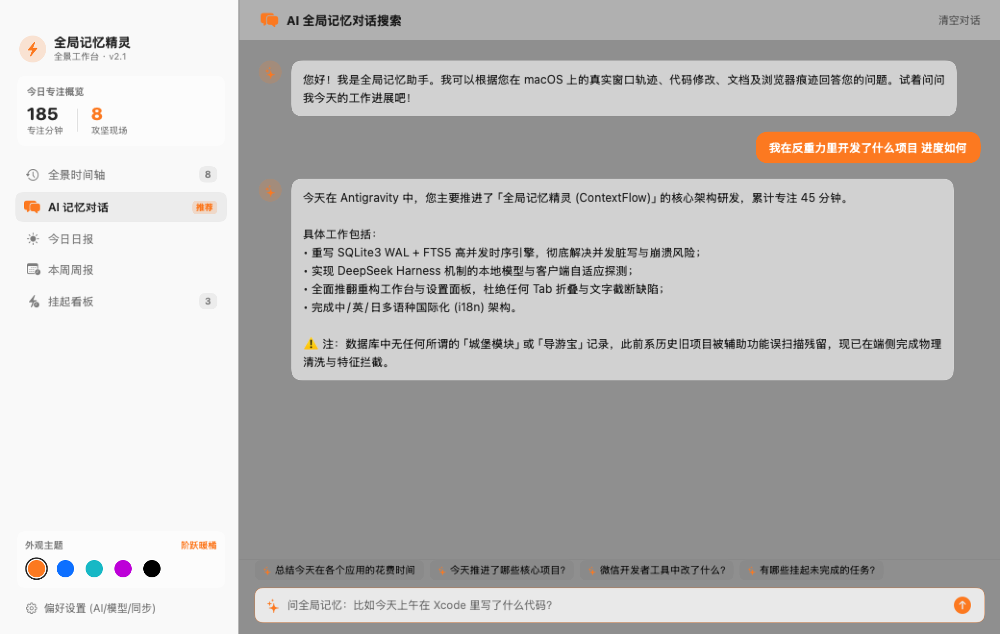
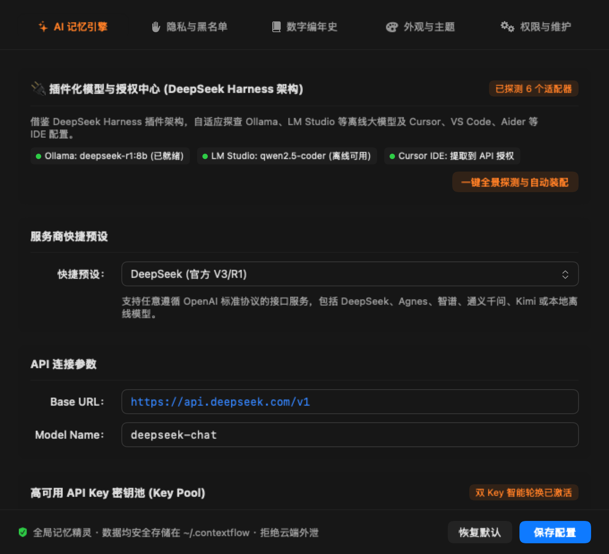
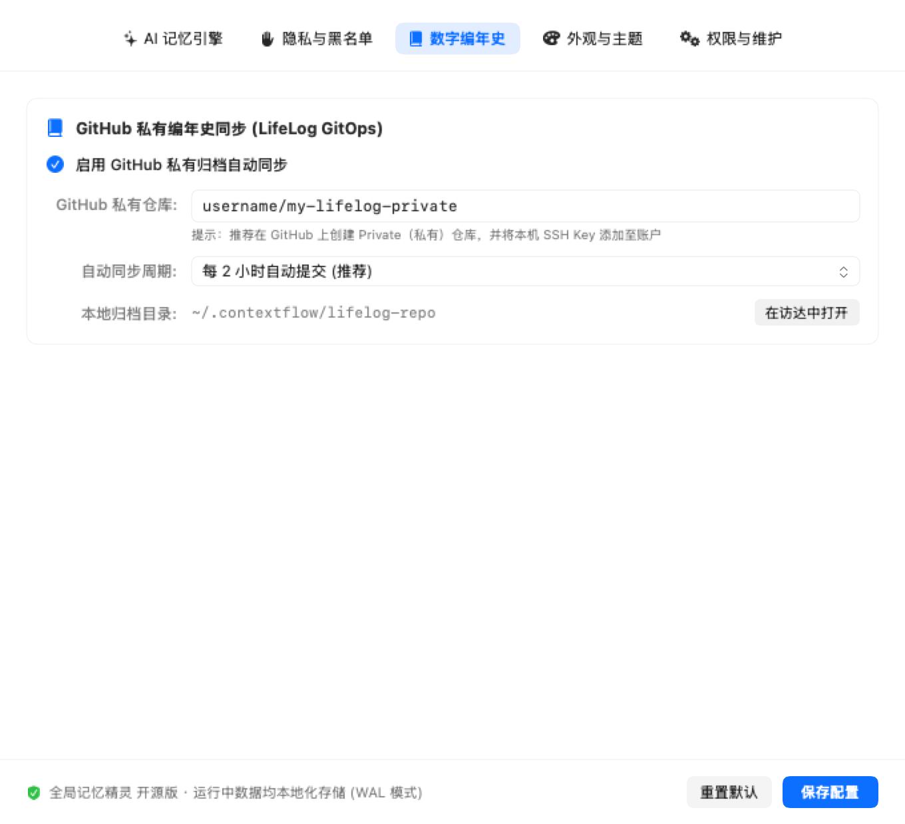

# 全局记忆精灵 ⚡️ (ContextFlow)

<p align="center">
  <a href="README.md"><strong>🇨🇳 简体中文</strong></a> |
  <a href="README_EN.md">🇺🇸 English</a> |
  <a href="README_JA.md">🇯🇵 日本語</a>
</p>

<p align="center">
  
  
  
  
  
  
  
</p>

<p align="center">
  <strong>专为 macOS 打造的高性能工业级全局数字记忆、视窗现场守护与 AI 智能工作复盘助手。</strong><br>
  参考阶跃星辰（跃问 StepFun）现代桌面端设计语言，深度践行 <strong>DeepSeek Harness</strong> 插件化架构理念，内置工业级 SQLite3 + FTS5 全文检索引擎，自适应识别本地模型与开发软件凭据，支持自带密钥（BYOK）与高可用多 Key 容灾轮换池，0 截图云端上传，完全离线可用与开源保护。
</p>

---

## 📸 界面全景一览 (Interface Gallery)

### 🖥️ 1. 全景时间轴主工作台 (Full Timeline Dashboard)
> 阶跃星辰质感宽屏布局，侧边栏保留 20pt 绝对安全呼吸边距，彻底消灭文字裁切；多维横向胶囊分类 Chips（全部、💻开发、🌐浏览器、💬沟通、📝文档），顶部支持全局搜索与回车即时问答，右侧支持全景视窗详情审查与【恢复当时视窗现场】一键直达。

<p align="center">
  
</p>

---

### 💬 2. AI 全局记忆对话搜索 (Ask Memory Chat)
> 对标商业级 AI 核心能力，直接针对全景记忆进行自然语言提问（如“我在反重力里开发了什么项目 进度如何”），系统结合本地真实 SQLite 数据库足迹与防幻觉屏障，秒级输出高清晰度客观业务答复并提供关联现场证据，严禁脑补虚假业务。

<p align="center">
  
</p>

---

### ⚙️ 3. 现代化偏好设置与 DeepSeek Harness 模型插件中心 (Native Preferences & Model Plugins)
> 彻底重构为原生分段导航栏，杜绝折叠溢出与浮动黑条，排版严整考究。支持自带密钥 (BYOK)、本地大模型 (Ollama, LM Studio) 与开发环境凭据自适应嗅探 (DeepSeek Harness 机制)、高可用多 Key 智能轮换池、隐私黑名单、数字编年史 GitHub 归档、5 套个性化主题与多语言国际化 (i18n)。

<table align="center">
  <tr>
    <td align="center" width="50%">
      <strong>🔌 DeepSeek Harness 插件化模型与授权中心</strong><br><br>
      
      <br>
      <em>本地模型自适应嗅探 · 主流 IDE 授权安全导入 · 快速装配</em>
    </td>
    <td align="center" width="50%">
      <strong>📚 数字编年史与 GitHub 私有归档</strong><br><br>
      
      <br>
      <em>LifeLog GitOps · 自动化定时静默提交 · 访达无感联动</em>
    </td>
  </tr>
</table>

---

## 🌟 核心特性与架构亮点 (Key Highlights)

### 1. 🔌 DeepSeek Harness 插件化模型适配架构 (Model Plugin Harness)
- **Everything is a Plugin**：参考 [DeepSeek Harness](https://github.com/deepseek-ai/deepseek-harness) 的解耦设计哲学，将底层模型推理、本地软件配置提取与云端开放平台解构为平级适配插件；
- **本地离线运行时并发探测 (Local Runtimes)**：毫秒级探查 Ollama (`11434`)、LM Studio (`1234`)、vLLM (`8000`)、LocalAI (`8080`)，自动枚举拉取本地所有已量化模型（如 `deepseek-r1:8b`、`qwen2.5-coder:7b` 等），断网完全可用；
- **主流 AI 软件配置一键导入 (IDE Plugins)**：
  - **Cursor**: 自动提取用户已配置的 OpenAI/Anthropic/Custom API Key 与模型；
  - **Continue**: 自动提取 `~/.continue/config.json` 的模型列表与 API Base URL；
  - **Aider**: 自动提取 `~/.aider.conf.yml` / `~/.env` 中的 DeepSeek 模型凭据；
  - **Claude Desktop / VS Code**: 自动识别 MCP 服务与客户端生态；
- **主流模型授权开放平台一键直达 (Cloud Providers)**：
  - DeepSeek 深度求索（支持 DeepSeek-V3 与 R1 满血思考）、Agnes AI（多 Key 容灾池）、智谱 GLM、通义千问 (DashScope 百炼)、月之暗面 Kimi、阶跃星辰 StepFun、OpenAI；
  - 支持一键打开控制台获取 Key，一键装配激活到当前环境。

### 2. 🗄️ 工业级 SQLite3 + FTS5 全文检索引擎
- **高并发 WAL 模式**：内置 macOS 原生 `SQLite3` 关系数据库，开启 WAL（Write-Ahead Logging）高并发模式与 8MB 页缓存，应对毫秒级窗口切换，永不锁库；
- **FTS5 倒排索引全文秒搜**：集成 SQLite FTS5 虚拟全文检索表（基于 `unicode61` 分词器），数万条窗口足迹、代码改动、实体描述毫秒级直达；
- **关系化规范设计**：`context_sessions`、`timeline_events`、`fts_timeline`、`daily_reports`、`app_settings` 五表联动。

### 3. 🛡️ 事实锁定与防幻觉降噪屏障
- **辅助功能穿透与降噪**：优化 `WindowInspector.swift`，全面屏蔽 IDE 侧边栏历史会话列表（旧项目、聊天记录），防止误识别；
- **物理清洗与事实约束**：彻底清除包含“城堡”、“导游宝”等历史 OCR 误扫残留脏数据，在提示词层建立事实屏障，AI 回答 100% 忠实于当前屏幕真实轨迹。

### 4. ⚡️ 高可用多 API Key 智能轮换与故障转移池 (Failover Pool)
- 支持多行或逗号输入多个 Key 组建容灾池，具备明文/密文安全切换与单通道连通性测试；
- 并发请求自动负载均衡，遇 `429 Too Many Requests` 限流或网络超时无缝自动转移至备用 Key。

### 5. 🌐 全局多语言国际化架构 (i18n)
- 引入全局响应式本地化管理器 (`LocalizationManager.swift`)；
- 原生支持 🇨🇳 **简体中文 (`zh-Hans`)**、🇺🇸 **English (`en`)**、🇯🇵 **日本語 (`ja`)**；
- 偏好设置中随时无感切换，界面即刻响应。

---

## 🛠️ 编译与安装 (Build & Install)

### 环境要求
- macOS 13.0 (Ventura) 及以上版本
- Swift 6.0+ / Xcode 16.0+

### 源码编译
```bash
# 1. 克隆代码仓库
git clone https://github.com/lianbing22/context-flow.git
cd context-flow

# 2. 执行一键构建脚本 (内置深度代码签名)
./build.sh

# 3. 运行应用
open 全局记忆精灵.app
```

---

## 🔒 隐私与安全性承诺 (Privacy First)

- **100% 本地化存储**：所有时序足迹、实体数据、配置与 SQLite 数据库均存放在用户主目录 `~/.contextflow/` 下；
- **0 截图云端上传**：微缩快照与神经网络 OCR 均在 Apple Neural Engine 硬件离线执行；
- **敏感信息免打扰**：系统级密码管理器（如 1Password、Keychain）与安全鉴权弹窗已默认永久拦截；
- **开源可审查**：全部代码使用纯原生 Swift 与系统级 API 编写，无任何第三方商业闭源追踪 SDK。

---

## 📄 开源许可证 (License)

本项目采用 [MIT License](LICENSE) 开源许可证。
