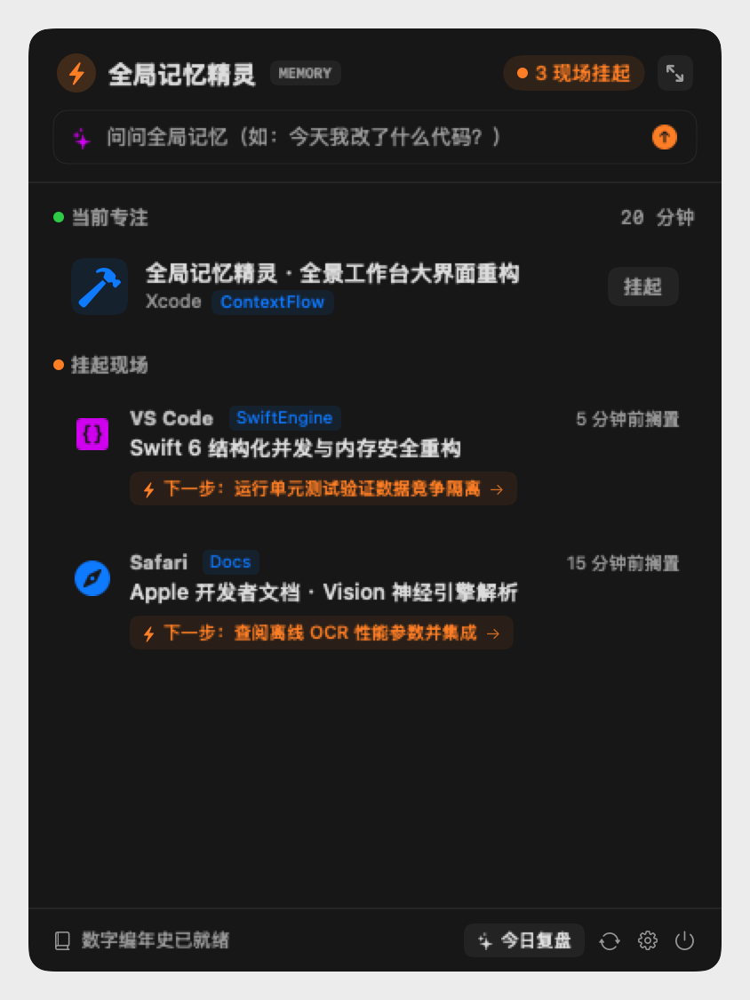

# 全局记忆精灵 ⚡️ (ContextFlow)

<p align="center">
  
  
  
  
  
</p>

<p align="center">
  <strong>专为 macOS 打造的轻量级商业级全局工作记忆、现场守护与每日智能复盘助手。</strong><br>
  对齐商业级应用（Rewind / 阶跃AI）核心能力，端侧离线视觉穿透，自带模型密钥（BYOK），0 截图云端上传，完全保护隐私与开源自由。
</p>

---

## 📸 界面一览 (Screenshots)

<table align="center">
  <tr>
    <td align="center" width="33%">
      <strong>⚡️ 主菜单栏浮窗 (Main Panel)</strong><br><br>
      
      <br>
      <em>微缩视窗快照 · 下一步行动胶囊 · 记忆智能检索</em>
    </td>
    <td align="center" width="33%">
      <strong>⚙️ 开源设置面板 (BYOK Settings)</strong><br><br>
      
      <br>
      <em>支持 DeepSeek / 智谱 / OpenAI / 本地 Ollama</em>
    </td>
    <td align="center" width="33%">
      <strong>☀️ 每日复盘与晨报 (Daily Briefing)</strong><br><br>
      
      <br>
      <em>攻坚业务实体总结 · 专注时长 · 一键复制 Markdown</em>
    </td>
  </tr>
</table>

---

## 💡 为什么你需要全局记忆精灵？

在现代日常办公与研发中，你经常面临这些痛点：
* **多任务频繁切换**：正在处理合同或查资料，突然被微信、临时会议打断，切回来后根本想不起“刚才改到哪一步了”；
* **传统工具很“傻”**：只看得到进程名（如 `Chrome`、`Finder`），根本不知道你屏幕上真正开着的业务是**“腾讯云代付协议在线签署”**还是**“接口重构”**；
* **车轱辘废话**：假 AI 工具动辄输出“使用浏览器应用”、“处理相关任务”，毫无业务信息量；
* **隐私顾虑**：商业闭源录屏软件动辄上传屏幕至云端，面临严重的安全和隐私泄露风险。

**全局记忆精灵在后台为你提供：**
1. **真实视窗穿透**：穿透 Chromium / Webkit 内核（Chrome、Edge、ego lite、Safari）与现代 IDE，直接嗅探真实标签页标题、业务平台与文件路径；
2. **端侧神经网络视觉（Apple Neural Engine）**：离开瞬间由本地离线神经引擎毫秒级 OCR 提炼屏幕核心文字，**屏幕快照绝不上传云端，完全本地化**；
3. **拒绝套话，直击业务**：严格的 Anti-Slop 反废话机制，精准提炼具体业务实体（如：`腾讯云 · 代付协议在线签署确认`）；
4. **行动化胶囊**：提供【⚡️ 下一步：... →】可交互行动胶囊，点击一键唤醒并恢复当时的工作窗口現場；
5. **权限长效锁定**：采用固定 Designated Requirement 深度签名，一次授权长期有效，升级重启绝不反复弹窗。

---

## 🚀 极速上手 (Quick Start)

### 1. 克隆仓库与一键编译
需要 macOS 13.0+ 及 Xcode Command Line Tools (`xcode-select --install`)。
```bash
git clone https://github.com/lianbing22/context-flow.git
cd context-flow

# 赋予执行权限并一键编译
chmod +x build.sh
./build.sh
```
编译脚本会在项目根目录下构建生成已完成深度长效签名的 `全局记忆精灵.app`。

### 2. 启动应用
```bash
open 全局记忆精灵.app
```
启动后，菜单栏右上角将出现 `⚡️` 常驻图标。

### 3. 授权说明 (请求一次，长期有效)
首次启动时，根据提示在 macOS【系统设置 -> 隐私与安全性】中授予两项基础权限：
- **辅助功能 (Accessibility)**：用于毫秒级捕获前台窗口标题与浏览器当前标签；
- **屏幕录制与快照 (Screen Recording)**：用于在切换离开瞬间由 Apple 本地神经引擎离线抓取核心大字实体。

> **无需担心反复弹窗**：本项目采用固定 Designated Requirement 签名（`app.memoryelf`），系统 TCC 数据库将权限永久绑定至应用标识，重新编译升级也无需反复授权。

---

## ⚙️ 设置指南 (Configuration Guide)

点击状态栏浮窗底部的 **齿轮 ⚙️** 图标，即可打开开源设置控制台：

### 1. 🤖 AI 记忆引擎配置 (自带密钥 BYOK)
全局记忆精灵支持任意兼容 OpenAI 标准协议的大模型接口：

| 服务提供商 | 默认 Base URL | 推荐模型 | 特点 |
| :--- | :--- | :--- | :--- |
| **DeepSeek (官方)** *(推荐)* | `https://api.deepseek.com/v1` | `deepseek-chat` | 性价比极高，中文业务实体提炼极为敏锐 |
| **智谱 GLM-4-Flash** | `https://open.bigmodel.cn/api/paas/v4` | `glm-4-flash` | 毫秒级极速响应，新用户有充足免费额度 |
| **OpenAI (官方)** | `https://api.openai.com/v1` | `gpt-4o-mini` | 国际标准接口，稳定通用 |
| **SiliconFlow (硅基流动)** | `https://api.siliconflow.cn/v1` | `Qwen/Qwen2.5-7B-Instruct` | 开源大模型高并发中转 |
| **Ollama (本地离线)** | `http://localhost:11434/v1` | `qwen2.5:7b` | **完全离线断网运行，0元开销，隐私绝密** |
| **自定义兼容中转 (Custom)** | 自定义输入 | 自定义输入 | 支持任意第三方 API 或自建网关 |

* **测试连通性**：填入你的 API Key 后，点击【测试连通性】，系统会自动发送心跳并回显网络延迟（如 `✓ 连接成功！响应延迟 220ms`）；
* **离线无 Key 保护**：若暂不配置 API Key，全局记忆精灵将自动启用 Apple Neural Engine 本地离线规则与实体提取，功能完全可用，0 报错。

### 2. 🛡️ 隐私与黑名单 (Privacy Exclusions)
* **默认安全机制**：1Password、KeePassXC、Keychain Access 等密码管理器与系统安全鉴权弹窗已预置在永久过滤名单中；
* **自定义黑名单**：在文本框中输入你希望忽略的应用名（如游戏、私人聊天等）并点击“添加”，该应用在前台时将完全不记录、不挂起、不生成快照。

### 3. 📖 数字编年史与私有归档 (GitHub Sync)
* 在 GitHub 上新建一个 **Private（私有）** 空仓库（例如 `yourname/my-digital-lifelog`）；
* 在设置中勾选 **“启用 GitHub 私有归档自动同步”**，并填入仓库名；
* 设置自动同步周期（如每 2 小时自动同步）；
* 全局记忆精灵会在本地生成结构化的 Markdown 编年史，并静默推送到你的私有仓库，实现终身数字资产私有永存。

### 4. 🎛️ 感知参数调节
* **微打断宽限时间**：滑块支持 10s ~ 120s 调节（默认 30 秒）。临时切去微信回一句话、去备忘录看一眼手机号小于该时长，均视为主任务背景音，不打断原工作现场。
* **状态栏常驻上限**：支持 3 ~ 15 个现场调节（默认 5 个），超出自动沉淀为已完成归档，保持菜单栏轻量清爽。

---

## 🏗️ 架构与工程设计

```
context-flow/
├── 全局记忆精灵.app          # 构建生成的独立原生应用
├── build.sh                 # 工程一键编译与深度代码签名脚本
├── Info.plist               # App 元数据与权限声明
├── LICENSE                  # MIT 开源许可证
├── README.md                # 商业级项目使用指南
├── docs/
│   └── screenshots/         # 高清产品展示截图
└── Sources/
    ├── main.swift           # 应用生命周期启动入口
    ├── Models.swift         # 数据实体 (ContextItem, ContextSession, AppSettings)
    ├── ContextStore.swift   # 本地数据持久化存储 (~/.contextflow/data.json)
    ├── WindowInspector.swift# 毫秒级窗口与浏览器标签深度穿透器
    ├── SnapshotManager.swift# 本地 Vision 神经网络离线 OCR 与微缩截图生成器
    ├── AISummarizer.swift   # Anti-Slop 业务实体提炼与自然语言问答引擎
    ├── ContextEngine.swift  # 场景判定状态机 (打断过滤、挂起、生命周期管理)
    ├── Restorer.swift       # 一键唤醒与现场还原执行器
    ├── LifeLogSyncManager.swift # GitHub 私有编年史异步自动化同步器
    ├── MenuBarManager.swift # 状态栏 NSStatusItem 与交互管理器
    ├── PermissionsManager.swift # TCC 权限诊断与长效锁定检测
    ├── Views.swift          # SwiftUI 现代主 Popover 界面与全景复盘弹窗
    ├── SettingsView.swift   # SwiftUI 全功能 4-Tab 配置中心
    ├── AppIconManager.swift # 原生应用图标高保真缓存渲染器
    └── Logger.swift         # 本地运行日志记录器 (~/.contextflow/contextflow.log)
```

---

## 🔒 隐私与安全性

1. **绝对本地化**：所有屏幕窗口的分析均在你的 Mac 本机执行；
2. **0 图像上传**：快照仅在本地 `~/.contextflow/snapshots/` 保留低分辨率微缩图，绝不上传到任何服务器；
3. **数据自主**：所有数据均以标准 JSON 格式保存在本地 `~/.contextflow/data.json`，随时可在访达中查看或一键清除；
4. **无后门、无遥测**：项目完全开源，代码透明无任何第三方埋点统计。

---

## 📄 开源许可证

本项目基于 [MIT License](LICENSE) 开源发布，欢迎提交 Issue 与 Pull Request 共同打造更好的 macOS 工作现场守护体验！
