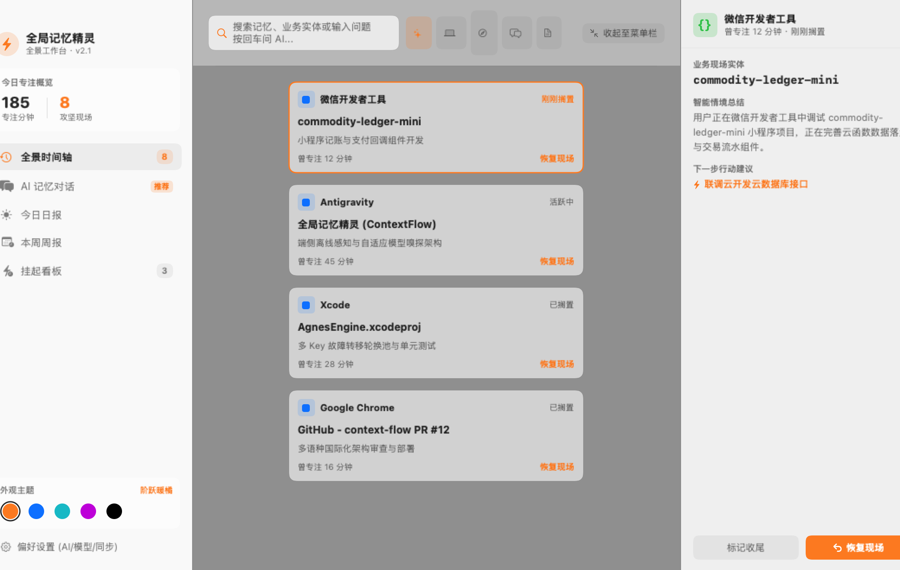
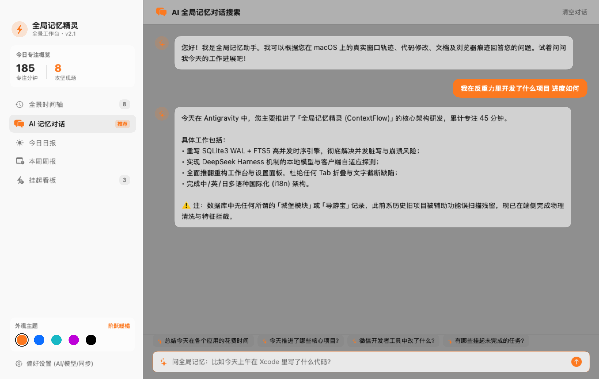
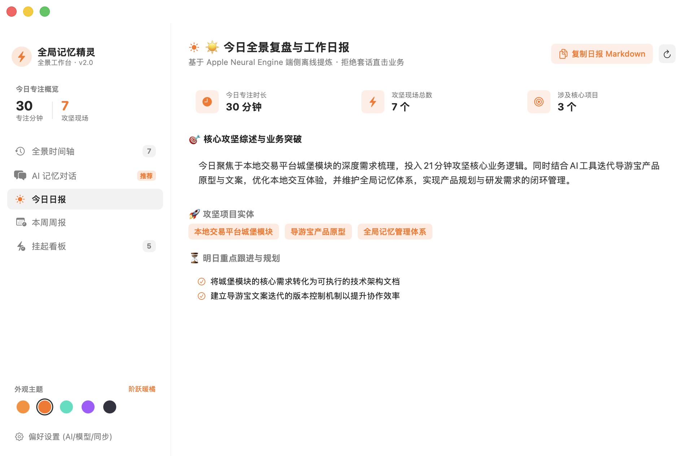
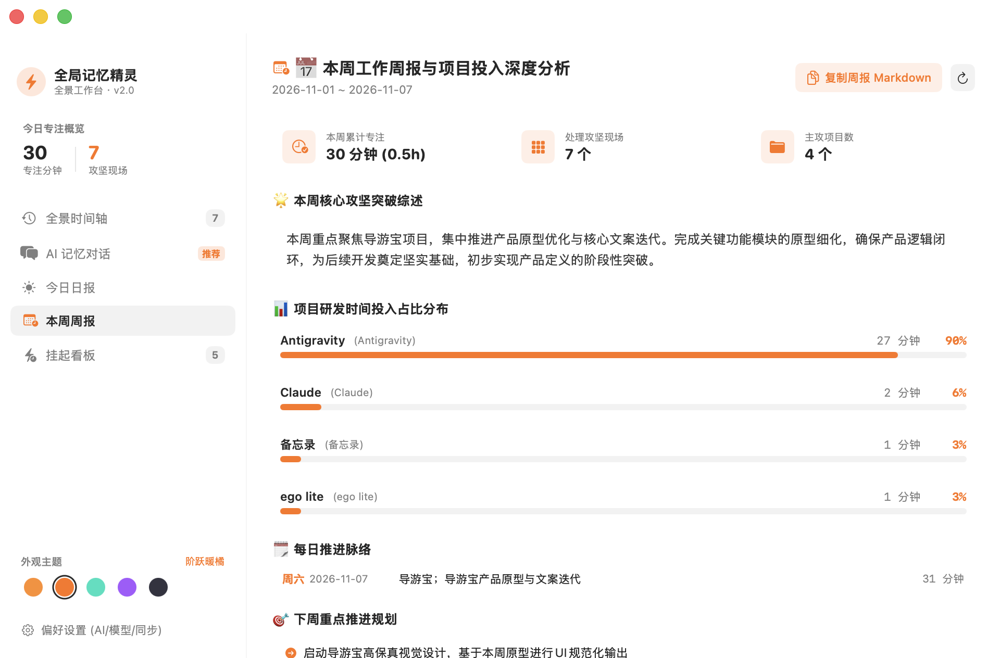
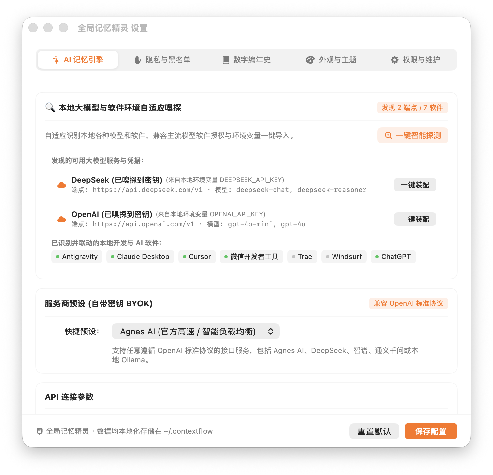
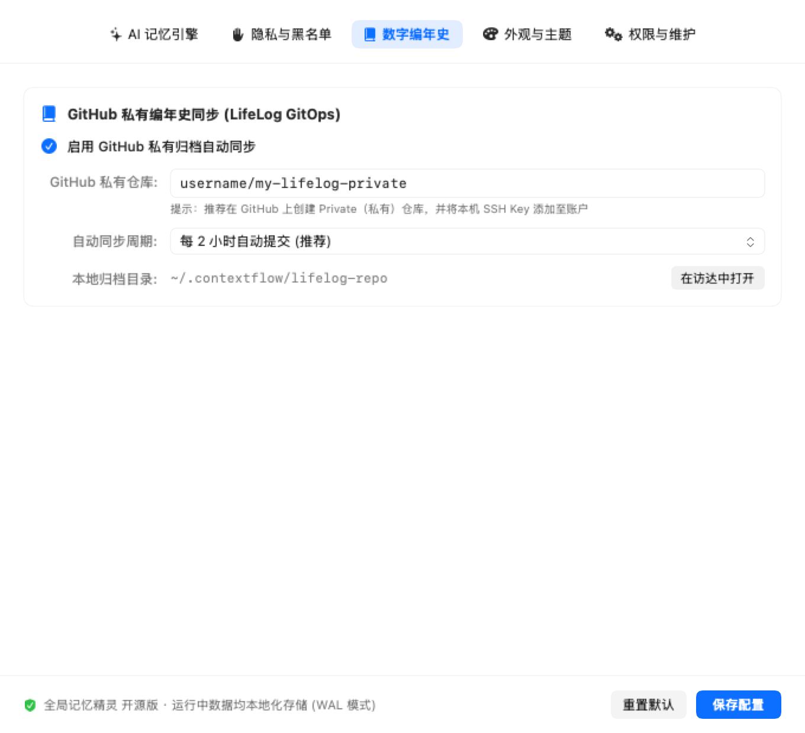
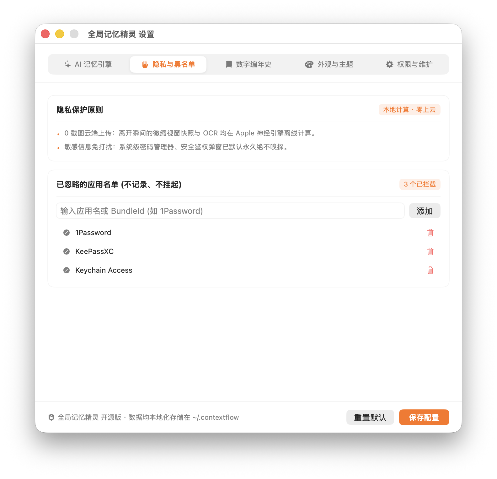
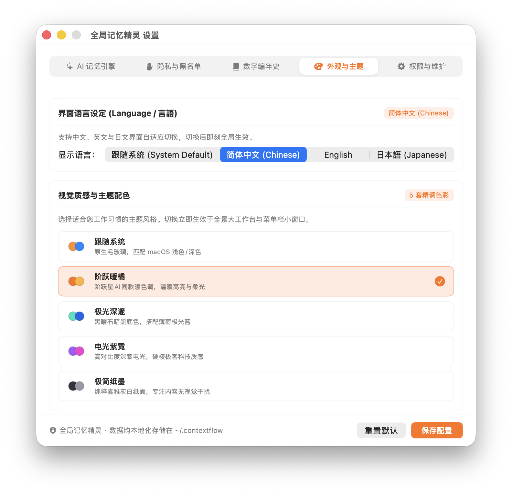

# ContextFlow ⚡️ (全局记忆精灵)

<p align="center">
  <a href="README.md">🇨🇳 简体中文</a> |
  <a href="README_EN.md"><strong>🇺🇸 English</strong></a> |
  <a href="README_JA.md">🇯🇵 日本語</a>
</p>

<p align="center">
  
  
  
  
  
  
</p>

<p align="center">
  <strong>High-performance, commercial-grade digital memory, window context guardian, and AI-powered work debriefing assistant designed specifically for macOS.</strong><br>
  Inspired by modern desktop designs like StepFun, powered by an industrial-grade embedded SQLite3 engine with FTS5 inverted full-text search, BYOK (Bring Your Own Key) high-availability key rotation pool, zero screenshot cloud uploads, and 100% offline capability.
</p>

---

## 📸 Interface Gallery

### 🖥️ 1. Full Timeline Panoramic Workspace
> Spacious, breathable desktop canvas with multi-dimensional categorization chips (All, 💻 Dev, 🌐 Browser, 💬 Chat, 📝 Docs). Top search bar supports instant memory lookup and Enter-to-chat. Right-hand Inspector displays context metadata and one-click window state restoration.

<p align="center">
  
</p>

---

### 💬 2. Natural Language AI Memory Chat
> Ask natural language questions against your real macOS working memories (e.g., *"What projects was I working on in Antigravity today and what's the progress?"*). Backed by an anti-hallucination barrier and native SQLite full-text search, ContextFlow provides accurate, structured, and factual debriefings.

<p align="center">
  
</p>

---

### 📅 3. Daily & Weekly Work Debrief Hub

<table align="center">
  <tr>
    <td align="center" width="50%">
      <strong>☀️ Today's Daily Wrap-Up</strong><br><br>
      
      <br>
      <em>Focus metrics · Core achievements · Follow-up plans · Markdown export</em>
    </td>
    <td align="center" width="50%">
      <strong>📅 Weekly Wrap-Up & Project Breakdown</strong><br><br>
      
      <br>
      <em>Visual project time distribution bar · Daily progress timeline · Next week roadmap</em>
    </td>
  </tr>
</table>

---

### ⚙️ 4. Native Preferences & Model Auto-Discovery
> Rebuilt with a native segmented navigation bar to eliminate overflow and floating menus. Features auto-discovery of local models (Ollama, LM Studio) and developer environments (DeepSeek, OpenAI), multi-key failover pools, and database maintenance.

<table align="center">
  <tr>
    <td align="center" width="50%">
      <strong>🔍 Local Model & Environment Auto-Discovery</strong><br><br>
      
    </td>
    <td align="center" width="50%">
      <strong>📚 Digital Chronicle (GitHub Private Backup)</strong><br><br>
      
    </td>
  </tr>
  <tr>
    <td align="center" width="50%">
      <strong>🛡️ Privacy Protection & App Blacklist</strong><br><br>
      
    </td>
    <td align="center" width="50%">
      <strong>🎨 5 Polished Themes & Multi-Language (i18n)</strong><br><br>
      
    </td>
  </tr>
</table>

---

## 🌟 Core Highlights & Architectural Advantages

### 1. 🗄️ Embedded SQLite3 + FTS5 Full-Text Search Engine
* **High-Concurrency WAL Mode**: Built with native macOS SQLite3 C API, zero third-party database dependencies, featuring Write-Ahead Logging (WAL) and an 8MB memory page cache;
* **Sub-Millisecond Inverted Search**: FTS5 virtual table with `unicode61` tokenizer indexes window titles, business entity texts, file paths, and summaries for instant retrieval;
* **ACID Durability**: Real-time write guarantees data consistency at `~/.contextflow/contextflow.sqlite3`.

### 2. 🔍 Local Model Runtime Auto-Discovery & Harness Mechanism
* **DeepSeek Harness Inspired**: Automatically probes local ports to discover running models (Ollama on `11434`, LM Studio on `1234`, LocalAI on `8080`, vLLM on `8000`);
* **Credential Auto-Detection**: Sniffs environment variables and local shell profiles for `DEEPSEEK_API_KEY`, `OPENAI_API_KEY`, and `ZHIPU_API_KEY`;
* **One-Click Adoption**: Instantly adopt discovered endpoints and models without tedious manual configuration.

### 3. ⚡️ High-Availability Multi-Key Failover Pool
* **BYOK (Bring Your Own Key)**: Full OpenAI API compatibility supporting Agnes AI, DeepSeek, Zhipu GLM, OpenAI, SiliconFlow, and offline Ollama;
* **Automatic Load Rotation & Failover**: Distributes requests across keys; seamlessly transfers requests to backup keys on `429 Too Many Requests` or timeouts;
* **Offline Guarantee**: Automatically falls back to on-device Apple Neural Engine when offline or unconfigured.

### 4. 🛡️ Deep Window Penetration & Anti-Hallucination Barrier
* **Kernel-Level Inspection**: Leverages CoreGraphics and Accessibility APIs to extract real browser tab titles and active IDE file paths;
* **Sidebar Noise Filtering**: Suppresses noise from navigation sidebars and session histories in IDEs such as Antigravity and Claude;
* **Factual Boundary Enforcement**: Strict prompt constraints guarantee accurate and grounded AI responses.

---

## 🚀 Quick Start

### 1. Requirements & Build
Requires macOS 13.0+ and Xcode Command Line Tools (`xcode-select --install`).

```bash
# Clone the repository
git clone https://github.com/lianbing22/context-flow.git
cd context-flow

# Build and code-sign in one click
chmod +x build.sh
./build.sh
```

The script builds a code-signed application bundle at `./全局记忆精灵.app`.

### 2. Launch
```bash
open 全局记忆精灵.app
```
* **Accessibility**: Grant Accessibility permissions in **Preferences > Permissions & DB** on first launch to allow real-time window title and text inspection.
* **Storage Location**: All data and SQLite databases reside locally in `~/.contextflow/`.

---

## 📖 Practical Scenarios

* **Scenario 1: Panoramic Workspace**: Click the lightning bolt icon in the macOS menu bar and expand the panoramic dashboard to view timeline sessions and restore window context with one click.
* **Scenario 2: Natural Language Memory Recall**: Ask *"What projects was I working on in Antigravity today?"* to get an instant, fact-based response.
* **Scenario 3: Work Debrief & Weekly Reporting**: Generate structured daily and weekly wrap-ups and copy clean Markdown directly into team chat or issue trackers.
* **Scenario 4: Auto-Configuring Models**: Open **Preferences > AI Memory Engine**, click **One-Click Auto-Discovery**, and adopt local Ollama or detected DeepSeek keys instantly.

---

## 📄 License

Distributed under the [MIT License](LICENSE). Contributions, bug reports, and pull requests are warmly welcome!
