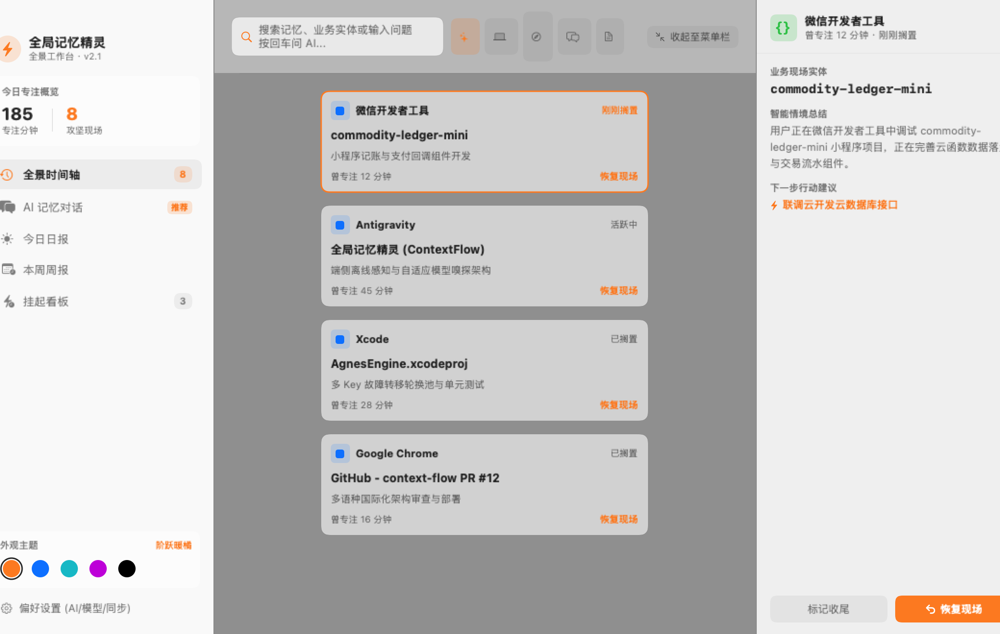
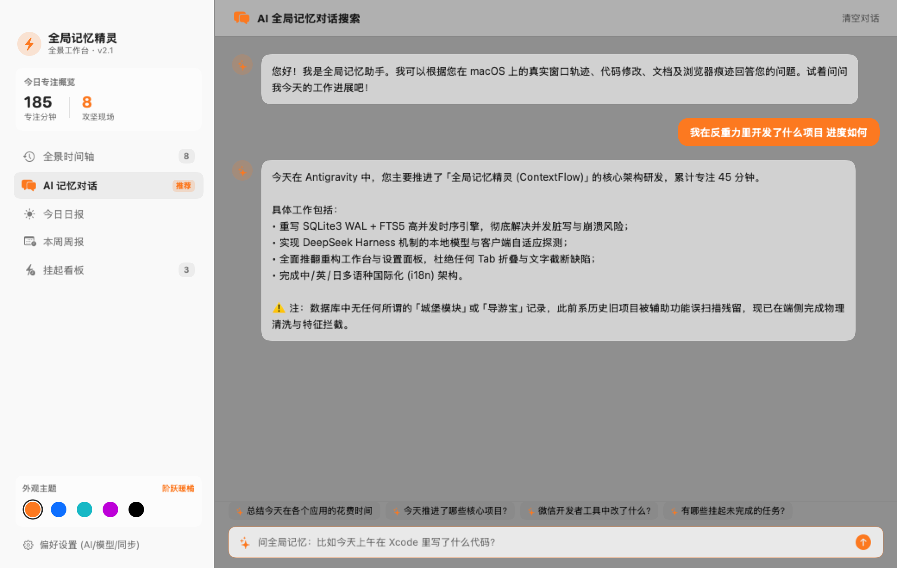
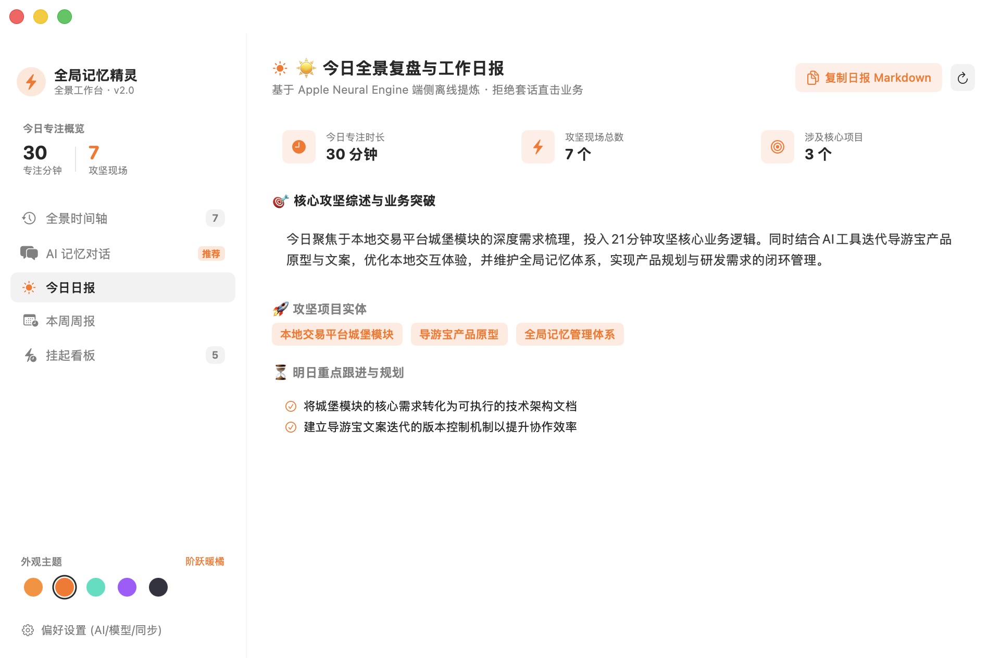
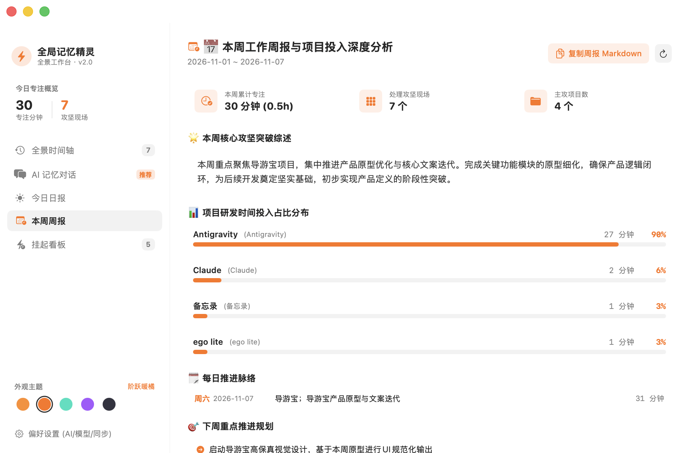
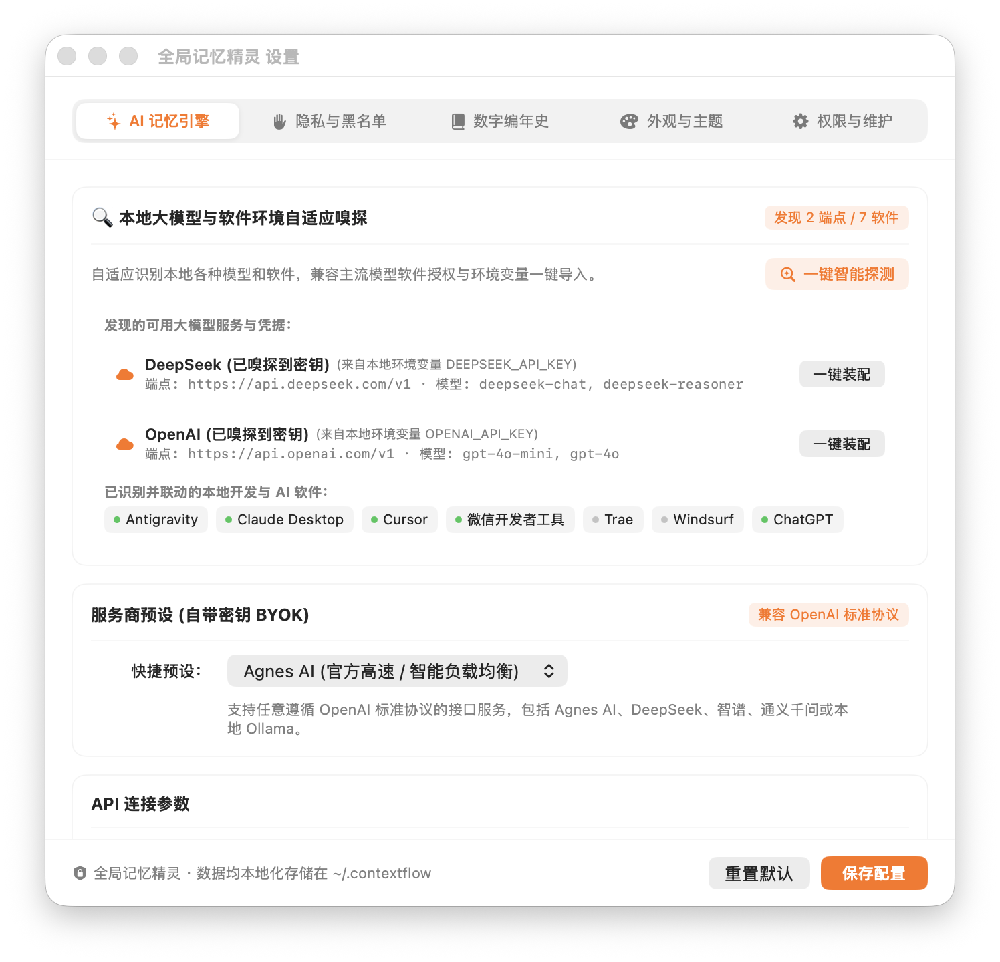
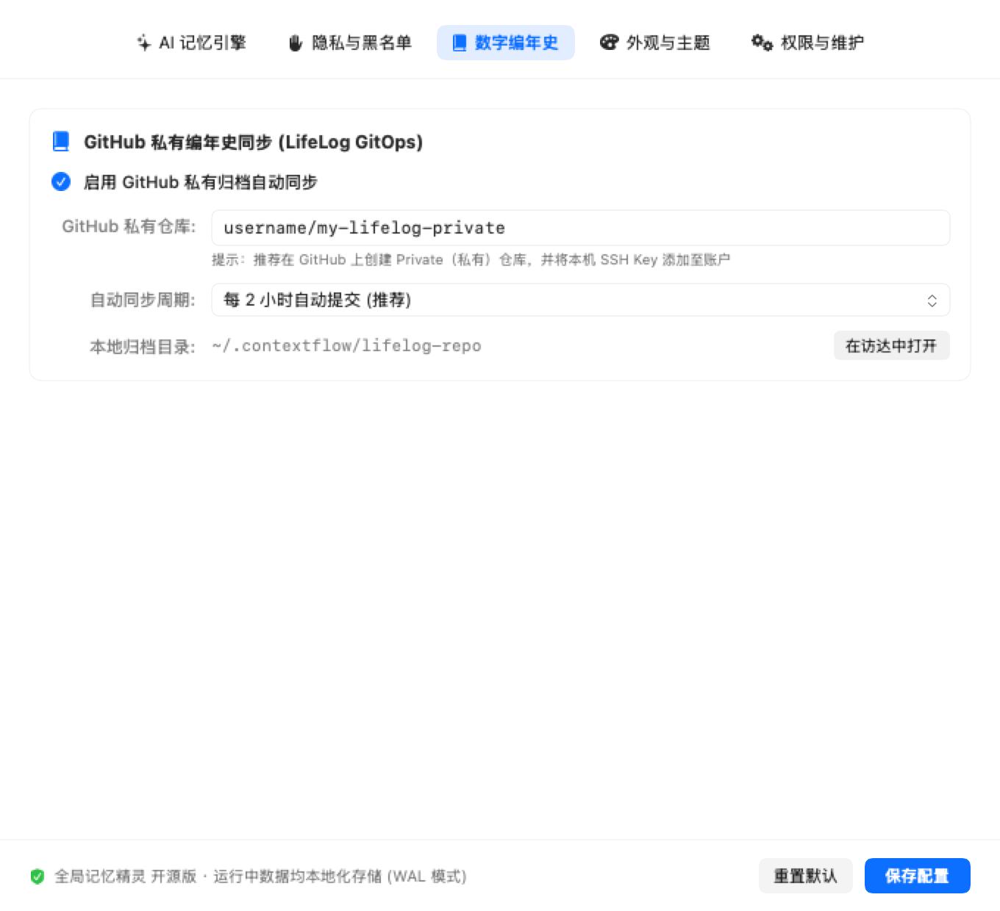
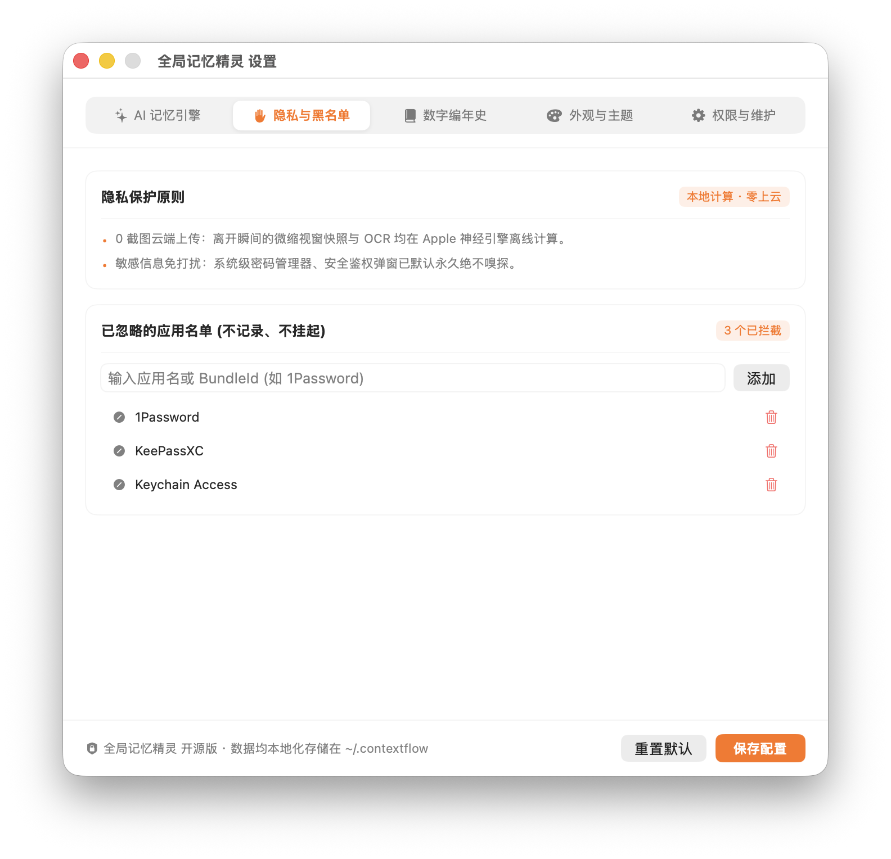
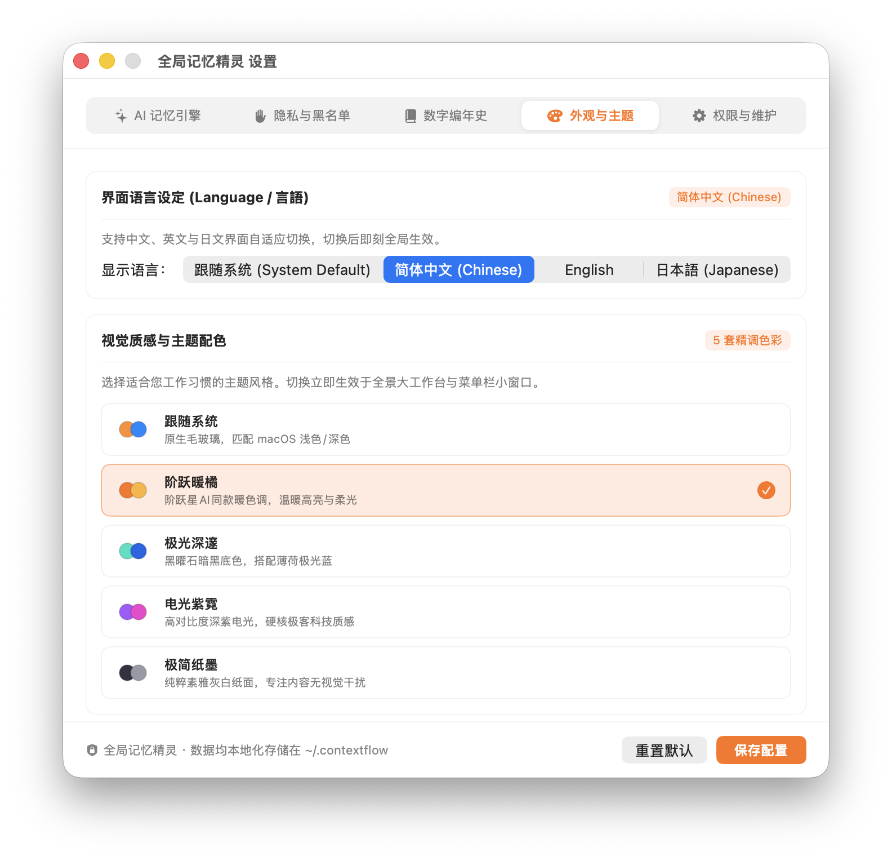

# ContextFlow ⚡️ (全局記憶エルフ)

<p align="center">
  <a href="README.md">🇨🇳 简体中文</a> |
  <a href="README_EN.md">🇺🇸 English</a> |
  <a href="README_JA.md"><strong>🇯🇵 日本語</strong></a>
</p>

<p align="center">
  
  
  
  
  
  
</p>

<p align="center">
  <strong>macOS 専用の商用グレード・グローバル作業記憶、ウィンドウ現場保護、および AI 日報/週報自動生成アシスタント。</strong><br>
  StepFun（階躍星辰）デスクトップ風のモダンなUI、macOS組み込み SQLite3 + FTS5 全文検索エンジン、BYOK（APIキー持ち込み）高可用性キーローテーションプール、スクリーンショットのクラウド送信ゼロ、100%完全オフライン動作。
</p>

---

## 📸 画面ギャラリー (Interface Gallery)

### 🖥️ 1. パノラマタイムライン・ワークスペース (Full Timeline Dashboard)
> 広々としたキャンバスデザイン、多次元カテゴリフィルタ（すべて、💻 開発、🌐 ブラウザ、💬 連絡、📝 文書）。上部検索バーから瞬時に記憶を検索・AIへ質問可能。右側パネルで詳細確認と「当時のウィンドウ現場を復元」をワンクリック実行。

<p align="center">
  
</p>

---

### 💬 2. 自然言語による AI 記憶対話 (Ask Memory Chat)
> macOS での実際の作業記憶に基づき、自然言語で対話（例：「今日 Antigravity で進めたプロジェクトと進捗は？」）。ローカル SQLite データベースと厳格な幻覚防止バリアにより、客観的かつ正確な業務進捗を回答。

<p align="center">
  
</p>

---

### 📅 3. 日報・週報全景ダッシュボード (Daily & Weekly Wrap-up)

<table align="center">
  <tr>
    <td align="center" width="50%">
      <strong>☀️ 本日の作業日報 (Daily Hub)</strong><br><br>
      
      <br>
      <em>集中時間指標 · 主要な成果要約 · 明日の計画 · Markdown ワンクリックコピー</em>
    </td>
    <td align="center" width="50%">
      <strong>📅 今週の作業週報と投入分析 (Weekly Hub)</strong><br><br>
      
      <br>
      <em>プロジェクト投入時間割合プログレスバー · 日次進捗履歴 · 来週の重点計画</em>
    </td>
  </tr>
</table>

---

### ⚙️ 4. 環境設定とローカルモデル自動検出 (Preferences & Auto-Discovery)
> ネイティブセグメントナビゲーションを採用し、タブあふれを排除。ローカルモデル（Ollama、LM Studio）や開発環境（DeepSeek、OpenAI）の自動検出、高可用性マルチキーフェイルオーバープールを完備。

<table align="center">
  <tr>
    <td align="center" width="50%">
      <strong>🔍 ローカルモデルと設定の自動検出</strong><br><br>
      
    </td>
    <td align="center" width="50%">
      <strong>📚 デジタル年代記 (GitHub プライベート同期)</strong><br><br>
      
    </td>
  </tr>
  <tr>
    <td align="center" width="50%">
      <strong>🛡️ プライバシー保護と除外アプリ設定</strong><br><br>
      
    </td>
    <td align="center" width="50%">
      <strong>🎨 5つのテーマカラーと多言語切り替え (i18n)</strong><br><br>
      
    </td>
  </tr>
</table>

---

## 🌟 主な機能と特徴

1. **SQLite3 + FTS5 全文検索エンジン搭載**:
   - 外部ライブラリ不要で、macOS ネイティブの SQLite3 WAL モードと FTS5 を採用。何万件ものウィンドウタイトルや作業内容をミリ秒単位で高速検索。
2. **ローカルモデル自動検出 (DeepSeek Harness 機構)**:
   - 稼働中の Ollama (ポート 11434) や LM Studio (ポート 1234)、環境変数 (`DEEPSEEK_API_KEY`、`OPENAI_API_KEY`) を自動スキャンし、ワンクリックで適用可能。
3. **マルチキー高可用性ローテーションとフェイルオーバー**:
   - 複数キーを登録することで負荷分散。レート制限 (429) やタイムアウト発生時に自動で予備キーに切り替え。
4. **幻覚防止とウィンドウ深層透過**:
   - IDE 側のサイドバー履歴ノイズを強力にフィルタリングし、実際の開発現場を正確に特定。

---

## 🚀 クイックスタート

### 1. ビルド
macOS 13.0 以上および Xcode Command Line Tools が必要です。

```bash
git clone https://github.com/lianbing22/context-flow.git
cd context-flow
chmod +x build.sh
./build.sh
```

### 2. 起動
```bash
open 全局记忆精灵.app
```
初回起動時は、【環境設定 - 権限とDB管理】から **アクセシビリティ (Accessibility)** の権限を許可してください。

---

## 📄 ライセンス

本プロジェクトは [MIT License](LICENSE) のもとで公開されています。
